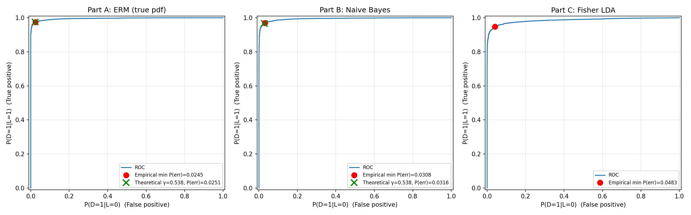

# Assignment 1, Question 1: ERM, Naive Bayes, and Fisher LDA Classifiers

Python code for Question 1. Two classes of 4-D Gaussian data are classified three ways, and the classifiers are compared with ROC curves and minimum probability of error.

- **Part A:** ERM likelihood-ratio test using the true class pdfs
- **Part B:** Naive Bayes (same test, but diagonal covariance matrices)
- **Part C:** Fisher LDA, with the projection estimated from the samples

## How to run

```bash
pip install -r requirements.txt
python q1_solution.py
```

The script:
1. Generates 10,000 samples (random seed 0) and saves them with their true labels to `q1_data.npz`
2. Computes the ROC curve for each classifier by sweeping the threshold
3. Prints the minimum-P(error) threshold, TPR, FPR, and P(error) for each part
4. Saves the plots `q1_roc_curves.png` and `q1_roc_comparison_zoom.png`

## Results

| Classifier | Min P(error) |
|---|---|
| ERM (true pdf) | 0.0245 |
| Naive Bayes | 0.0308 |
| Fisher LDA | 0.0483 |



## References
- R. O. Duda, P. E. Hart, D. G. Stork, *Pattern Classification*, 2nd ed., Wiley, 2001.
- C. M. Bishop, *Pattern Recognition and Machine Learning*, Springer, 2006.
- T. Fawcett, "An introduction to ROC analysis," *Pattern Recognition Letters*, 27(8), 2006.
- Code written with help from Claude (Anthropic), Oct. 2026.
